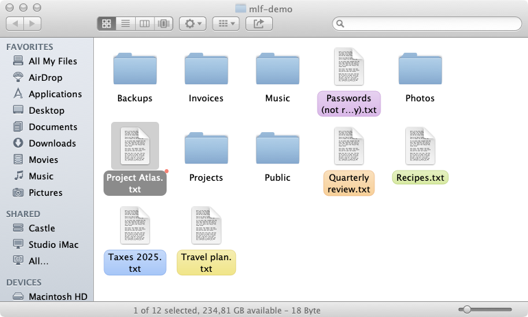
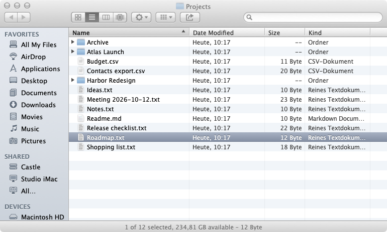
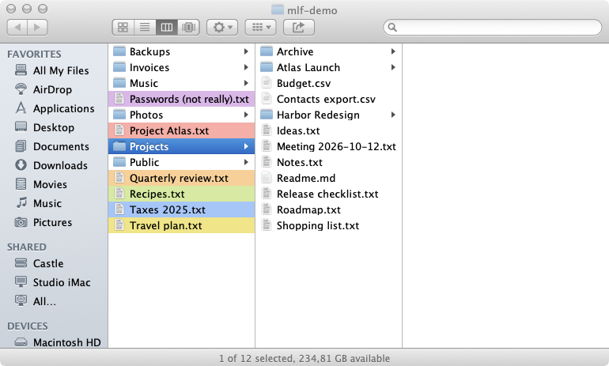
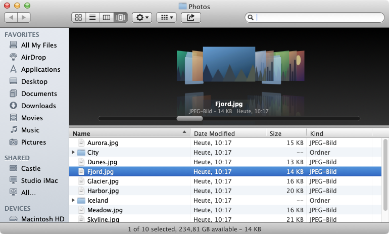
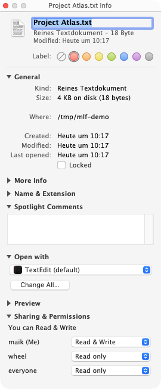
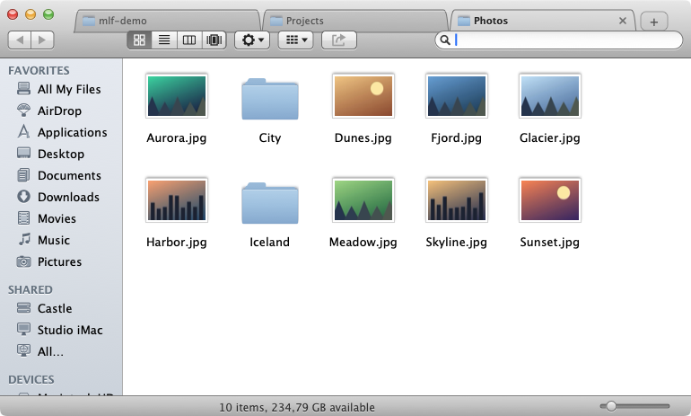
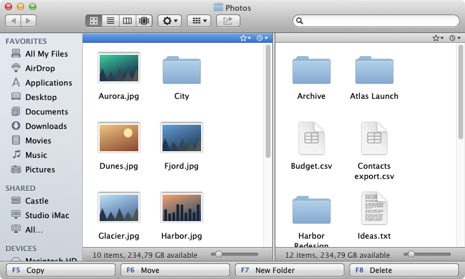
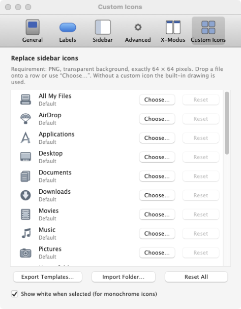

# RetroFind

A native macOS file manager in the style of the **Finder of OS X 10.8 Mountain Lion** – skeuomorphic Aqua chrome, four views, sidebar, search and Quick Look – working on your **real files** (no mock-up), plus an optional **X-Mode** for power users: tabs *or* dual pane, batch rename, a transfer queue and more.

<p align="center"></p>

> Swift 5.9 · AppKit · macOS 14 or later · Apple Silicon and Intel · English and German · GPL-3.0
>
> **Note:** RetroFind is a non-commercial fan project, made out of respect for Apple. It is an independent project and is not affiliated with Apple Inc. The design is *inspired by* OS X 10.8. Apple, Mac, macOS, OS X, Finder and Mountain Lion are trademarks of Apple Inc.

## Features

- **Four views** – icons (free placement or grid, grouping), list (expandable folders, sortable/movable/resizable columns), columns (preview column) and **Cover Flow** (perspective covers with reflections, synchronized list).
- **Window like the original** – 55 pt title bar + toolbar, 136 pt sidebar, status and path bar, toolbar overflow (»), customizable toolbar, minimum window size, zoom to ideal size. System traffic lights by default, optional **Aqua traffic lights** (Ø 12 pt) in the preferences.
- **Sidebar** – Favorites, Shared (Bonjour servers), Devices (with eject), Search For; add folders by dropping them, reorder, drag out to remove, collapse and reorder groups. Own-drawn monochrome icons or **colored icons** (setting), and every sidebar icon can be replaced on the **Custom Icons** preferences page (PNG, transparent, 64 × 64).
- **File operations** – copy/move with metadata preserved (`copyfile`), conflict dialog (replace / keep both / merge / skip), progress with cancel, undo/redo, duplicate, real aliases, ZIP, Trash with *Put Back*, burn folders.
- **Search** – Spotlight search bar (This Mac / folder / shared), criteria (kind, name, contents, dates, size, label), **smart folders** (`.savedSearch`), *All My Files*.
- **Info & more** – Get Info with sections and inspector, colour labels, Spotlight comments, *Open With*, permissions, Quick Look, Share menu, AirDrop hand-off, *Connect to Server*, preferences (General, Labels, Sidebar, Advanced), view options (⌘J).
- **File display options** (General) – show `~/Library`, show hidden files, always show folders on top.
- **Menus** – Finder, File, Edit, View, Go (⌥ reveals *Library*), Window, Help, with the historical shortcuts.

### X-Mode (Preferences ▸ X-Mode)

- **Tabs *or* dual pane** (radio buttons). *Tabs:* ⌘T new, ⌘W close, ⇧⌘[ / ⇧⌘] switch, ⌥⌘1…9 jump, ⇧⌘T reopen closed tab, drag to reorder, tabs restored after relaunch; the active tab merges seamlessly into the toolbar.
- **Dual pane** – two full panes side by side with a footer: **F5 Copy · F6 Move · F7 New Folder · F8 Delete** (keys and buttons), Tab switches the active pane, ⌥⌘P toggles, ⌥⌘= mirrors the other pane, ⌥⌘X swaps panes, select/deselect by pattern (⌘+ / ⌘−).
- **Per-pane history** (⌥↓ or the clock button) and **per-pane favorites** (⌥⌘B or the star button, drop folders onto the star).
- **Transfer queue** (⌥⌘Q) – sequential copy/move jobs with progress, speed, remaining time, pause, per-job cancel, conflict policy (ask / replace / keep both / skip / only newer) and optional verification (size + SHA-256).
- **Batch rename** (⌥⌘R) – replace, add text, number/format (`{name} {n}`), change case, regular expression; live preview with conflict detection; one undo step.
- **Folder sizes on demand** (⌥⇧⌘S or *Calculate Size* in the context menu), **Terminal Here** (⇧⌥⌘T, choose your terminal app), **Copy Path** (⌥⌘C).
- **Custom app icon** (Preferences ▸ Advanced) – any PNG of exactly 256 × 256 pixels.
- **Custom Icons** (Preferences ▸ Custom Icons) – swap any sidebar icon: choose or drop a transparent 64 × 64 PNG per row, export editable templates, import a folder of `<key>.png` files, reset one or all.

## Screenshots

<table>
<tr>
<td></td>
<td></td>
</tr>
<tr><td align="center">List (⌘2)</td><td align="center">Columns (⌘3)</td></tr>
<tr>
<td></td>
<td></td>
</tr>
<tr><td align="center">Cover Flow (⌘4)</td><td align="center">Get Info (⌘I)</td></tr>
<tr>
<td></td>
<td></td>
</tr>
<tr><td align="center">X-Mode: tabs</td><td align="center">X-Mode: dual pane</td></tr>
<tr>
<td></td>
<td></td>
</tr>
<tr><td align="center">Preferences ▸ Custom Icons</td><td></td></tr>
</table>

*All images show synthetic demo data (`Reference/make_demo.py`, run with `-demo`), taken with the Aqua traffic lights enabled.*

## Installation

Download the signed and notarized DMG from the [latest release](../../releases), open it and drag the app to *Applications*. Requires macOS 14 or later (Apple Silicon and Intel). On first launch macOS asks for access to folders such as Desktop, Documents and Downloads.

## Build from source

```bash
./build.sh          # universal (arm64 + x86_64) → build/RetroFind.app (signed with your Apple Development identity or ad-hoc)
./release.sh        # Developer ID + hardened runtime → notarize → DMG (add "publish" for a GitHub release)
python3 Reference/make_icon.py              # redraw the original app icon → Resources/AppIcon.icns
python3 Reference/make_demo.py              # synthetic demo data for screenshots (/tmp/mlf-demo)
```

`release.sh` needs a “Developer ID Application” certificate in the keychain and a `notarytool` profile (`NOTARY_PROFILE`, default `Retromac`). `HARDENED=1 ./build.sh` signs with hardened runtime and timestamp.

## Testing

```bash
APP=build/RetroFind.app/Contents/MacOS/RetroFind
$APP -selftest                                   # ~80 automated checks: copy/metadata, conflicts, merge, undo, aliases, trash, labels, search, tabs, dual pane, batch rename, transfer queue, folder sizes, history, favorites
$APP -fresh -uitest -open=/some/folder           # walks the UI paths (four views, search, info, preferences, dialogs) and reports crashes
$APP -fresh -lang=en -demo -status -open=/tmp/mlf-demo -snap=/tmp/x.png -quit   # PNG of the window
# more switches: -view=icon|list|column|cover  -select=Name  -size=WxH  -realshot  -aqua  -xmode [-dual] [-tabs=a,b] [-right=path]  -show=prefs|info|viewopts|rename|queue
python3 Reference/compare.py /tmp/x.png 0 0 300 60 4   # pixel comparison against the reference screenshot
```

## Documentation

[`docs/FUNKTIONSMATRIX.md`](docs/FUNKTIONSMATRIX.md) maps every requirement of the specification to its implementation and test · [`docs/MESSKATALOG.md`](docs/MESSKATALOG.md) lists measured dimensions and sources · [`docs/ABWEICHUNGEN.md`](docs/ABWEICHUNGEN.md) lists what is not (fully) possible on a current macOS · [`docs/ICONS-CREDITS.md`](docs/ICONS-CREDITS.md) documents the origin of all artwork.

## Limitations

- Not available on today’s macOS (or only through system services): secure empty Trash, FTP writing and AFP, the 10.8 AirDrop protocol, Facebook/Flickr/Vimeo sharing, Folder Actions, the original AppleScript dictionary.
- The minimum window size (380 × 200) and some dimensions (column view) are working values – they were not measured on a real 10.8 installation. Pixel comparisons use screenshots only.
- Burning and volume encryption are implemented but untested without the hardware.
- Not available in the Mac App Store; distribution is GitHub only.

## License & legal

- **Code:** [GNU General Public License v3.0](LICENSE) (GPL-3.0). Copyright © 2026 Maik Klotz.
- **Fan project:** RetroFind is a non-commercial fan project, made out of respect and admiration for Apple and the design of OS X 10.8. It is free of charge, makes no claim to any Apple trademark, design or artwork, and is provided "as is" without warranty (GPL-3.0, sections 15–16). If you are a rights holder and have a concern, please open an issue – I will respond promptly and in good faith.
- **No affiliation with Apple:** RetroFind is an independent project, neither authorized nor endorsed by Apple. *Lucida Grande* is only referenced from the installed system.
- **Assets:** all icons (sidebar glyphs, folders, toolbar, traffic lights) are **original drawings** created for this project (`Glyphs.swift`) and covered by the GPL. No third-party or Apple artwork is bundled.
- **App icon:** `Resources/AppIcon.icns` is a user-supplied, AI-generated image (built with `Reference/make_icon_from_image.py`) and is **not** covered by the GPL; all rights reserved by the author. It resembles the former Apple Finder icon, so forks should ship their own – use the *App icon* setting (PNG 256 × 256) or `Reference/make_icon.py` (an original, GPL-covered alternative drawing). Icons you add yourself via *Custom Icons* stay in `~/Library/Application Support/RetroFind/CustomIcons` on your machine and are not part of the app or this repository.
